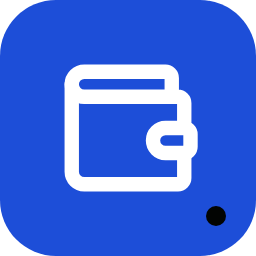
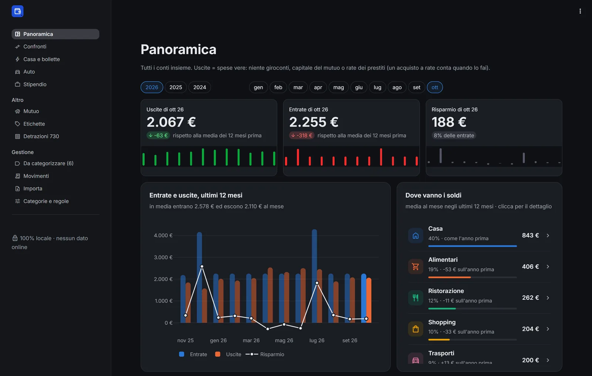
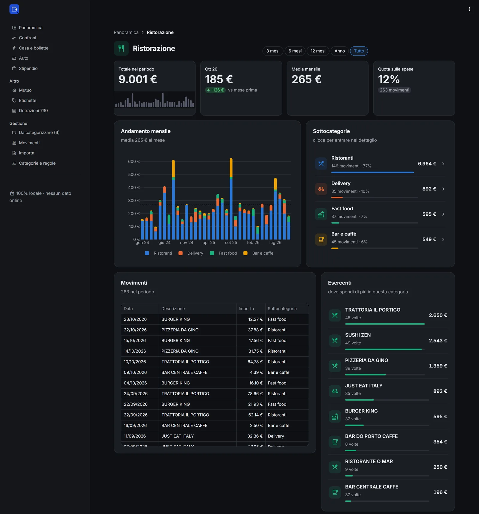
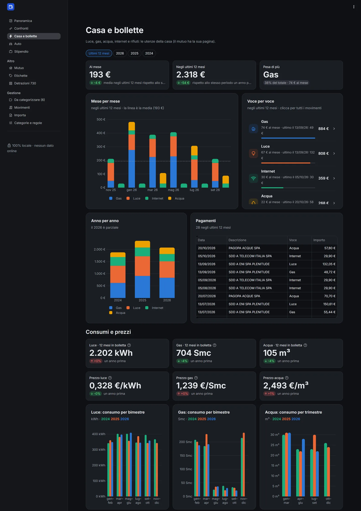

<p align="center">
  
</p>

<h1 align="center">Money</h1>

<p align="center">
  Reads your bank statements, bills and payslips on your own PC, sorts every expense and shows where the money goes.<br>
  <a href="#english">English</a> · <a href="#italiano">Italiano</a> · <a href="https://davide-mariotti.github.io/apps/money">Website</a>
</p>

<p align="center">
  <a href="https://ko-fi.com/Z0X32ATNHL"></a>
</p>

<p align="center">
  
</p>
<p align="center">
   
</p>

---

## English

### What it does

- Reads the documents your bank and your suppliers already give you: Nexi credit card statements, Crédit Agricole account statements and CSV lists, Hype, Revolut and PayPal exports, Eni Plenitude electricity and gas bills, Acque SpA water bills, Zucchetti payslips.
- Checks every file against the totals printed on it. If the movements don't add up to the total, or the closing balance doesn't follow from the opening one, the file is not imported and Money says why.
- Recognises each document by its content, renames it, compresses it and files it in the right folder (`carta/2026-01_nexi.pdf`, `bollette/2026-09_luce.pdf`). Importing the same file twice changes nothing.
- Sorts every movement into categories on three levels (Home › Utilities › Electricity). You pick the category of an unknown merchant once: it becomes a rule, and the same merchant is sorted by itself from then on.
- Shows the month against the 12 before it, where the money goes, where you're spending more than usual, your subscriptions, budgets and a savings goal. Then comparisons by month, quarter and year, home and bills (consumption and the real price per kWh, Smc and cubic metre), car, salary (raises, taxes, holidays, severance pay), mortgage, tags for things like a trip, and an estimate of the deductions for the Italian tax return.
- Counts nothing twice: the card's monthly debit on the account, top-ups between your own accounts and the capital of a mortgage are kept out of spending.

### What it doesn't do

- It doesn't connect to your bank. No credentials, no open banking: you download the statements, Money reads them.
- It doesn't send your data anywhere. No cloud, no account, Streamlit's telemetry switched off, the page reachable only from your own PC. The one exception is optional and yours: `drive.py` copies the PDFs and a backup to your own Google Drive and can fetch bill attachments from your Gmail, with your own Google client, only if you set it up.
- It doesn't read every bank in the world: only the formats above, for now. A new one is a reader function in `money.py`, checked against the totals the document prints.
- It isn't in English yet: the interface speaks Italian.
- It isn't one click yet: today it runs on Python. A Windows app of its own, with a window you drop the files on, is on its way (`desktop.py`).
- It doesn't give financial advice. It tells you where the money went; getting it back is up to you.

### Download

1. Install [Python](https://www.python.org/downloads/) 3.12 or newer (tick *Add python.exe to PATH*).
2. Download the code: *Code* → *Download ZIP*, and unzip it in a folder that stays put. Or `git clone https://github.com/davide-mariotti/Money.git`.
3. Double-click `Money.bat`. The first time it creates `.venv` and installs what it needs (a few minutes), then the browser opens on http://localhost:8599.

### How to use it

1. Put the PDFs and CSV files in `data/nuovi/`, or drag them into **Importa**. They are read, checked and filed at every start. Money starts from 1 January 2020.
2. **Da categorizzare**: one row per unknown merchant. Pick a category: it becomes a rule. Shorten the rule to make it broader (`coffeevending` instead of `abcdefghijcoffeevendingcity`).
3. **Panoramica**: the month you pick against the 12 before, where the money goes (click a category to go down a level), where you can cut back, budgets, the savings goal. **Confronti**, **Casa e bollette**, **Auto**, **Stipendio**, **Mutuo**, **Etichette**, **Detrazioni 730**: one page each.
4. **Movimenti**: search, filter, fix the category of one movement (rules leave it alone from then on), add a tag. **Categorie e regole**: categories, their icons ([Material Symbols](https://fonts.google.com/icons) names) and the rules.

Your data lives in `data/` (the SQLite database `money.db` and the filed PDFs), which git ignores. Copy that folder to keep a backup.

### How it works

1. Each reader in `money.py` recognises its document from the text, pulls out the movements and verifies them against what the document prints: the statement's total, the balances, the bill's total and consumption, the payslip's net pay.
2. Movements go into SQLite with an id made of account, date, description and amount, so importing again, or two statements that overlap, never duplicates.
3. Categories come from rules: the merchant's name, cleaned of codes and numbers (`AmazonNu7yy7tt4Luxembourg` becomes `amazonluxembourg`), contains the rule; the longest rule wins. Rules starting with `#` look at the original text, for customer codes and policy numbers.
4. The pages are built with [Streamlit](https://streamlit.io) and Plotly from the database each time you open them. A mortgage instalment is split into interest (spending) and capital (savings) on the fly; the database keeps the real line.

### Build from source

```cmd
.venv\Scripts\python test_money.py
```

checks the readers and the rules on synthetic documents, never on real statements. The new window: `.venv\Scripts\python desktop.py` from the folder, `build.bat` for `dist\Money.exe` (PyInstaller). The icons come from `assets/make-icons.py`.

### Support

If Money found the subscription you'd forgotten about, you can [buy me a coffee on Ko-fi](https://ko-fi.com/Z0X32ATNHL). That's how the next app gets written.

### License

[MIT](LICENSE). The libraries keep their own licenses: Streamlit (Apache-2.0), Plotly and pdfplumber (MIT), pikepdf (MPL-2.0), pywebview (BSD); the Inter, Geist and Instrument Serif fonts are under the SIL Open Font License.

---

## Italiano

### Cosa fa

- Legge i documenti che la banca e i fornitori ti danno già: estratti della carta Nexi, estratti e liste CSV del conto Crédit Agricole, export di Hype, Revolut e PayPal, bollette luce e gas Eni Plenitude, bollette dell'acqua di Acque SpA, buste paga Zucchetti.
- Controlla ogni file sui totali stampati. Se i movimenti non fanno il totale, o il saldo finale non torna da quello iniziale, il file non entra e Money ti dice perché.
- Riconosce ogni documento dal contenuto, lo rinomina, lo comprime e lo archivia nella cartella giusta (`carta/2026-01_nexi.pdf`, `bollette/2026-09_luce.pdf`). Importare due volte lo stesso file non cambia niente.
- Smista ogni movimento in categorie su tre livelli (Casa › Utenze › Luce). La categoria di un esercente sconosciuto la scegli una volta: diventa una regola, e da lì in poi quell'esercente si smista da solo.
- Ti fa vedere il mese contro i 12 prima, dove vanno i soldi, dove stai spendendo più del solito, gli abbonamenti, i budget e un obiettivo di risparmio. Poi i confronti per mese, trimestre e anno, casa e bollette (consumi e prezzo vero per kWh, Smc e metro cubo), auto, stipendio (aumenti, tasse, ferie, TFR), mutuo, etichette per cose come un viaggio, e una stima delle detrazioni per il 730.
- Non conta niente due volte: l'addebito mensile della carta sul conto, le ricariche tra i tuoi conti e il capitale del mutuo restano fuori dalle spese.

### Cosa non fa

- Non si collega alla banca. Niente credenziali, niente open banking: gli estratti li scarichi tu, Money li legge.
- Non manda i tuoi dati da nessuna parte. Niente cloud, niente account, telemetria di Streamlit spenta, la pagina raggiungibile solo dal tuo PC. L'unica eccezione è facoltativa e tua: `drive.py` copia i PDF e un backup sul tuo Google Drive e può prendere gli allegati delle bollette da Gmail, con il tuo client Google, solo se lo configuri.
- Non legge tutte le banche del mondo: per ora i formati qui sopra. Uno nuovo è una funzione di lettura in `money.py`, controllata sui totali che il documento stampa.
- Non parla ancora inglese: l'interfaccia è in italiano.
- Non è ancora a un clic: oggi gira con Python. Un'app per Windows tutta sua, con una finestra su cui trascinare i file, è in arrivo (`desktop.py`).
- Non dà consigli finanziari. Ti dice dove sono finiti i soldi; riprenderli tocca a te.

### Scaricarlo

1. Installa [Python](https://www.python.org/downloads/) 3.12 o più recente (spunta *Add python.exe to PATH*).
2. Scarica il codice: *Code* → *Download ZIP*, e scompattalo in una cartella che non sposti. Oppure `git clone https://github.com/davide-mariotti/Money.git`.
3. Doppio clic su `Money.bat`. La prima volta crea `.venv` e installa quello che serve (qualche minuto), poi si apre il browser su http://localhost:8599.

### Come si usa

1. Metti i PDF e i CSV in `data/nuovi/`, o trascinali in **Importa**. A ogni avvio vengono letti, controllati e archiviati. Money parte dal 1° gennaio 2020.
2. **Da categorizzare**: una riga per ogni esercente sconosciuto. Scegli una categoria: diventa una regola. Accorcia la regola per renderla più generica (`coffeevending` invece di `abcdefghijcoffeevendingcitta`).
3. **Panoramica**: il mese che scegli contro i 12 prima, dove vanno i soldi (clic su una categoria per scendere di livello), dove puoi limitarti, i budget, l'obiettivo di risparmio. **Confronti**, **Casa e bollette**, **Auto**, **Stipendio**, **Mutuo**, **Etichette**, **Detrazioni 730**: una pagina ciascuno.
4. **Movimenti**: cerca, filtra, correggi la categoria di un singolo movimento (le regole poi non lo toccano più), aggiungi un'etichetta. **Categorie e regole**: categorie, icone (nomi di [Material Symbols](https://fonts.google.com/icons)) e regole.

I tuoi dati stanno in `data/` (il database SQLite `money.db` e i PDF archiviati), che git ignora. Per un backup copia quella cartella.

### Come funziona

1. Ogni funzione di lettura in `money.py` riconosce il suo documento dal testo, ne tira fuori i movimenti e li verifica su quello che il documento stampa: il totale dell'estratto, i saldi, il totale e i consumi della bolletta, il netto della busta paga.
2. I movimenti finiscono in SQLite con un identificativo fatto di conto, data, descrizione e importo, quindi reimportare, o due estratti che si sovrappongono, non duplica mai.
3. Le categorie vengono dalle regole: il nome dell'esercente, ripulito da codici e numeri (`AmazonNu7yy7tt4Luxembourg` diventa `amazonluxembourg`), contiene la regola; vince la regola più lunga. Le regole che iniziano con `#` guardano il testo originale, per codici cliente e numeri di polizza.
4. Le pagine sono fatte con [Streamlit](https://streamlit.io) e Plotly, dal database, ogni volta che le apri. Una rata del mutuo viene divisa al volo in interessi (spesa) e capitale (risparmio); nel database resta la riga vera.

### Compilarlo

```cmd
.venv\Scripts\python test_money.py
```

controlla le funzioni di lettura e le regole su documenti sintetici, mai su estratti veri. La finestra nuova: `.venv\Scripts\python desktop.py` dalla cartella, `build.bat` per `dist\Money.exe` (PyInstaller). Le icone le genera `assets/make-icons.py`.

### Supporto

Se Money ti ha fatto ritrovare l'abbonamento di cui ti eri dimenticato, puoi [offrirmi un caffè su Ko-fi](https://ko-fi.com/Z0X32ATNHL). È così che nasce la prossima app.

### Licenza

[MIT](LICENSE). Le librerie hanno le loro licenze: Streamlit (Apache-2.0), Plotly e pdfplumber (MIT), pikepdf (MPL-2.0), pywebview (BSD); i font Inter, Geist e Instrument Serif sono sotto SIL Open Font License.
